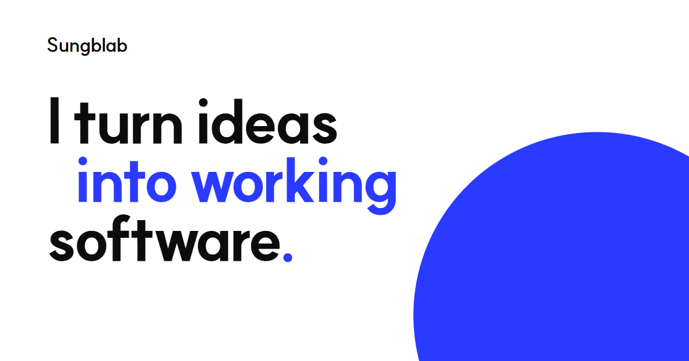

### Sungbin Kim

I'm studying Artificial Intelligence at Kookmin University.
I've been into computers since I was a kid, and I got into web development in 8th grade,
digging through GitHub and Stack Overflow. When I started using Claude 3 Opus
in early 2024, I could finally build the ideas that had only existed in my head.

When I run into a problem, I usually try to understand it by turning it into a
small tool — especially when it's something I've experienced or seen up close
myself. Rather than waiting until I fully understand something,
I start building and learn what I need along the way.

### Things I've built

| When | Project | What it was | Status |
| --- | --- | --- | --- |
| 2024.06 | [Face-recognition attendance](https://github.com/Sungblab/SB_face_recognition_system) | My first attendance system, built with Python and OpenCV. Used in real classes and study halls. | Ended |
| 2024 summer | [QR attendance](https://github.com/Sungblab/School-Attend-Web_System) | Check in with a QR code that changes every 30 seconds. | Ended |
| 2024.12 | [Sungblab AI](https://github.com/Sungblab/Sungblab_AI) | An AI service my friends and I used to write our school records. About 100 signups. | Ended |
| 2025.04 | [QR·RFID attendance](https://github.com/Sungblab/QR-RFID-Attendance) | The QR system rebuilt in React, with an RFID reader and an Arduino. | Ended |
| 2025.11 | Scrim Manager | League of Legends 5v5 scrims and match analysis. About 65 signups. | Ended |
| 2026.09 | [Bside](https://github.com/lim010111/bside) | Finds people nearby over BLE and has AI suggest who to meet. Grand prize at a joint university hackathon, team of four. | Contest |
| 2026.09 | [Meetpoint](https://github.com/Sungblab/meetpoint) | An event networking app that suggests who to meet. | Paused |
| 2026.10 | [Joleopgak](https://github.com/Jeon-ChaeA/AI-BUILDER-CHALLENGE) | A graduation-requirements checker. 2nd place at KOOKMIN AI BUILDER CHALLENGE, team of five. | Contest |

The full list, including the two projects I deleted, is on [sungblab.com](https://sungblab.com/#projects).

**Links:** [Website](https://sungblab.com) · [Blog](https://sungblab.com/blog) · [LinkedIn](https://kr.linkedin.com/in/sungblab) · [Email](mailto:sungblab@gmail.com)
