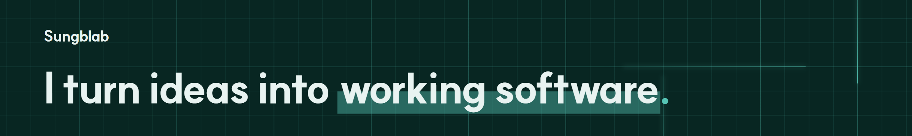

<a href="https://sungblab.com">
  <picture>
    <source media="(prefers-color-scheme: dark)" srcset="assets/banner-dark.png">
    
  </picture>
</a>

### Sungbin Kim

I'm studying Artificial Intelligence at Kookmin University. I got into computers early,
and started web development in 8th grade, digging through GitHub and Stack Overflow.
In early 2024 I started using Claude 3 Opus,
and ideas that had only lived in my head became things I could actually build.

Since then I've built and shipped a number of projects.
Now I build alongside coding agents, and I write down what I learn along the way.

**Links:** [Website](https://sungblab.com) · [Blog](https://sungblab.com/blog) · [LinkedIn](https://kr.linkedin.com/in/sungblab) · [Email](mailto:sungblab@gmail.com)
